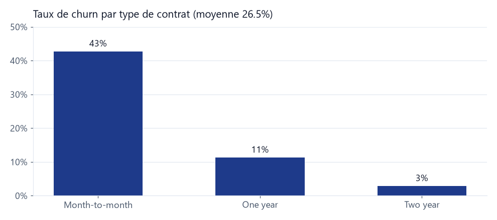
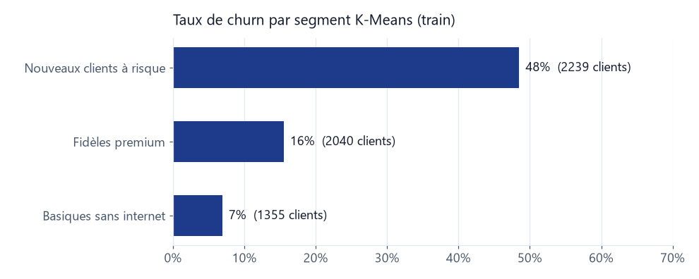
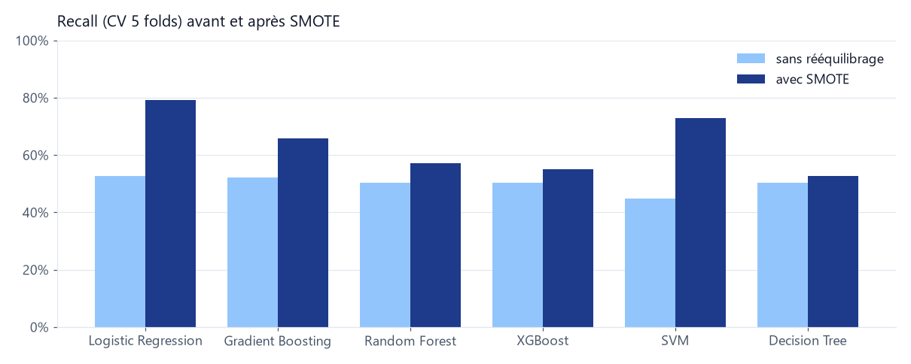

<p align="center">
  
</p>

# Customer Churn Prediction

Analyse, segmentation et prédiction du churn client sur le dataset **Telco Customer Churn**
(7 043 clients, 26.5 % de churn).

EDA, segmentation K-Means, classification, optimisation, suivi MLflow et application
Streamlit conteneurisée avec Docker.

## Données

- 11 valeurs `TotalCharges` vides (clients à `tenure = 0`) remplacées par 0.
- Aucun doublon, aucun outlier IQR.
- Feature engineering : `charges_per_tenure`, `is_new_customer`, `is_month_to_month`,
  `is_fiber`, `is_electronic_check`, `nb_services`, `tenure_band`.

<p align="center">
  
</p>

## Segmentation

K-Means avec k = 3, sans la variable `Churn` et sans `TotalCharges` (corrélée à 0.83 avec
`tenure`). Agglomerative et DBSCAN ont aussi été testés.

<p align="center">
  
</p>

## Classification

Six modèles comparés : Régression Logistique, Decision Tree, Random Forest, Gradient
Boosting, XGBoost et SVM. Le déséquilibre est traité avec `class_weight`, oversampling et
SMOTE.

<p align="center">
  
</p>

**Pas de data leakage :** le split train/test 80/20 stratifié est fait en premier.
Imputation, scaling, encodage, K-Means et SMOTE sont des étapes d'un `imblearn.Pipeline`,
ajustées sur le train uniquement et dans chaque fold de CV. Le seuil de décision est choisi
sur des prédictions out-of-fold. Le test ne sert qu'au score final.

## Résultats

| Étape | Constat |
|---|---|
| Déséquilibre | SMOTE / class_weight : recall de ~53 % à ~80 % (Régression Logistique) |
| Cluster comme variable | Gain de ROC-AUC entre -0.006 et +0.001, non significatif |
| Feature engineering | Léger gain pour les modèles simples, dans le bruit |
| Optimisation | Random Forest et XGBoost +0.025 de ROC-AUC |

**Modèle final :** Régression Logistique (C = 0.1) + SMOTE + feature engineering, seuil 0.56.

| Test | ROC-AUC | Recall | Precision | F1 |
|---|:---:|:---:|:---:|:---:|
| Modèle final | 0.844 | 0.75 | 0.54 | 0.63 |

Le cluster n'améliore pas la prédiction, il n'est donc pas utilisé par le modèle final. Il
sert à l'interprétation et il est affiché dans l'application.

## Installation

```bash
git clone https://github.com/eliasdeva/customer-churn-prediction.git
cd customer-churn-prediction
pip install -r requirements.txt
```

Exécuter les notebooks dans l'ordre, de 01 à 05. Le notebook 01 produit
`data/processed/clean_eng.csv`, utilisé par les suivants.

## Application Streamlit

```bash
streamlit run app/streamlit_app.py
```

L'utilisateur saisit les caractéristiques d'un client. L'application affiche son segment,
la probabilité de churn et la prédiction.

Avec Docker :

```bash
docker build -f docker/Dockerfile -t churn-app .
docker run -p 8501:8501 churn-app
```

Puis ouvrir http://localhost:8501.

## MLflow

Chaque expérience enregistre les hyperparamètres, le preprocessing, les métriques CV et
test, la matrice de confusion, la courbe ROC et le modèle. Le modèle final est enregistré
sous le nom `churn-model`.

```bash
mlflow ui --backend-store-uri sqlite:///mlflow.db
```

Puis ouvrir http://localhost:5000. `mlflow.db` n'est pas versionné : il est créé en
exécutant les notebooks. Un export est disponible dans `reports/mlflow_runs.csv`.

## Structure

```text
customer-churn-prediction/
├── app/streamlit_app.py      # Application de prédiction
├── artifacts/                # Modèle final, modèle de clustering, model_info.json
├── assets/                   # Images du README
├── data/raw/                 # Dataset brut
├── data/processed/           # Données nettoyées + feature engineering
├── docker/Dockerfile         # Image de l'application
├── notebooks/
│   ├── 01_eda.ipynb
│   ├── 02_clusters.ipynb
│   ├── 03_classification.ipynb
│   ├── 04_lien.ipynb
│   └── 05_optimisation_mlflow.ipynb
├── reports/                  # Graphiques et export MLflow
└── requirements.txt
```
